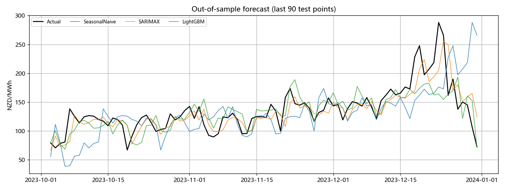

<div align="center">

# NZEM Spot Price Forecasting

From New Zealand electricity prices to walk-forward forecast comparisons.

  

[Quick start](#quick-start) · [Project map](#project-map) · [Reproduction guide](docs/REPRODUCIBILITY.md)

</div>

---

## Overview

An end-to-end forecasting pipeline for New Zealand Electricity Market prices: download, cleaning, exploratory analysis, feature engineering, model comparison and reporting.

```text
EMI prices → Preprocessing → Features → Forecast models → Backtest → Report
```

## Recorded benchmark

Original BEN2201 daily-mean study, 2023 data, 90-day hold-out and one-step-ahead evaluation:

| Model | MAE, NZD/MWh | RMSE, NZD/MWh | sMAPE |
|---|---:|---:|---:|
| SARIMAX | **16.59** | **23.83** | **12.28%** |
| LightGBM | 20.18 | 29.21 | 14.63% |
| Seasonal naive | 31.85 | 46.40 | 23.87% |

These are the repository's recorded results, not a new run.



## Quick start

```powershell
python -m pip install -r requirements.txt
python run_pipeline.py --no-cv
```

Run from the root. Use `python run_pipeline.py` to include walk-forward CV.

Choose the input mode in `config.yaml`:

| Setting | Behavior |
|---|---|
| `data.use_synthetic: false` | Download/cache real EMI prices for the configured node and period |
| `data.use_synthetic: true` | Use a built-in synthetic dataset without an EMI download |

Synthetic results do not reproduce the real-data benchmark.

## Project map

| Path | Role |
|---|---|
| [config.yaml](config.yaml) | Node, dates, input mode and modeling settings |
| [src/data/](src/data/) | Download and preprocessing |
| [src/features/](src/features/) | Lagged, rolling and calendar features |
| [src/models/](src/models/) | Shared interface and forecast models |
| [src/evaluation/](src/evaluation/) | Hold-out and walk-forward evaluation |
| [outputs/reports/report.md](outputs/reports/report.md) | Recorded report |

## Data and modeling notes

Prices are node-specific. Demand and hydro-storage series are optional exogenous inputs and require separate data integration for the real-data workflow. Record timestamp/DST treatment, forecast horizon and input mode when comparing runs.

The earlier modeling discussion and full figure gallery are preserved in [the project reference](docs/PROJECT_REFERENCE.md).

## License

[MIT](LICENSE).

## Documentation

- [Reproduction guide](docs/REPRODUCIBILITY.md): inputs, execution order and validation limits.
- [Code and artifact map](docs/REPOSITORY_MAP.md): source and configuration paths.

<sub>Research artifacts reflect the recorded experiment settings. Full results were not regenerated during documentation cleanup.</sub>
